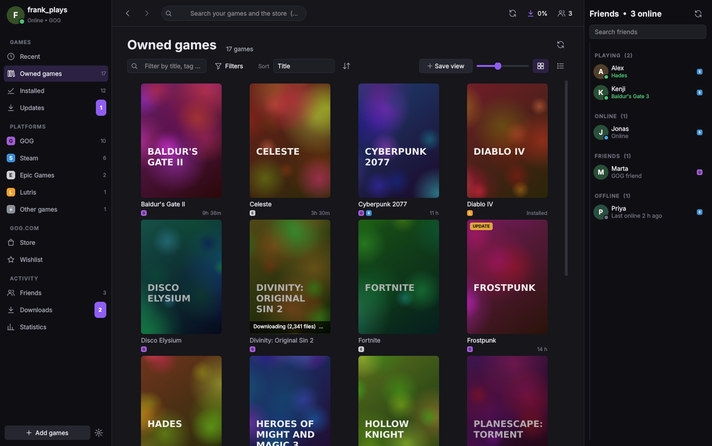
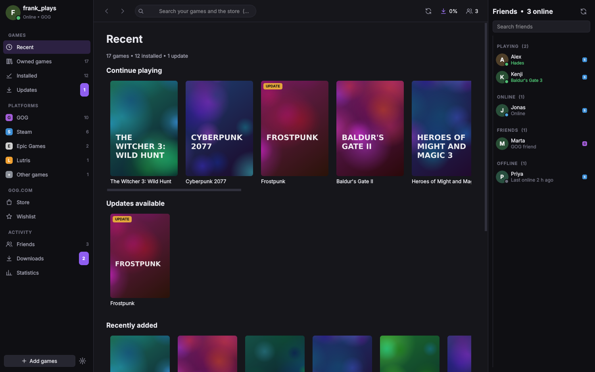
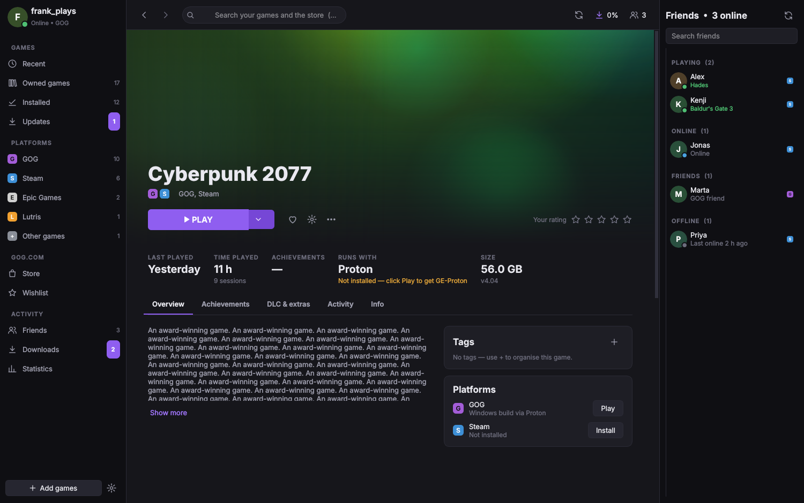
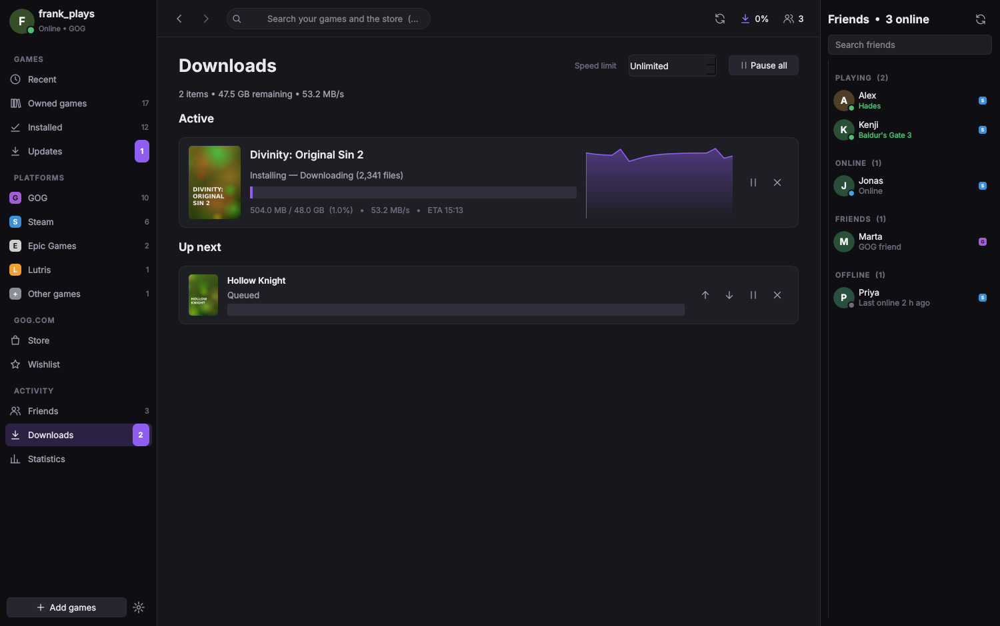
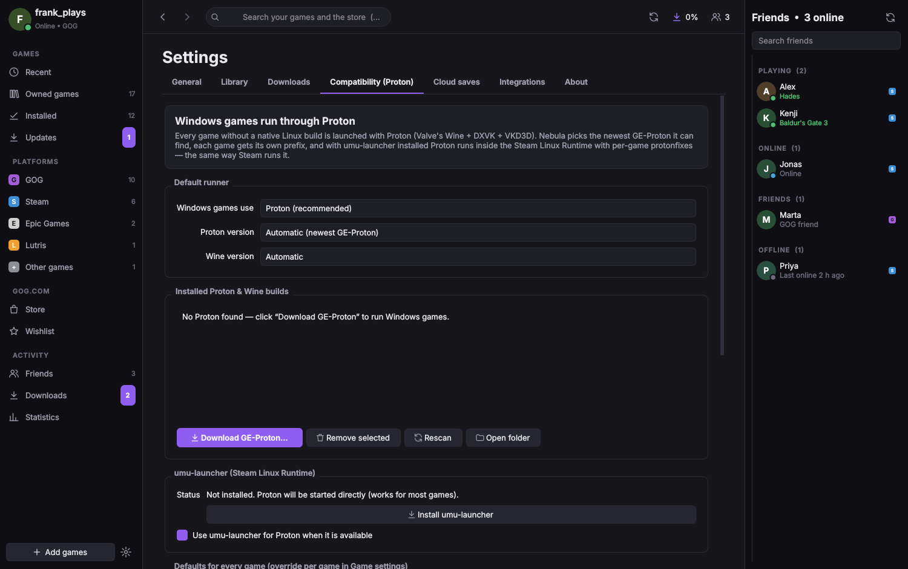
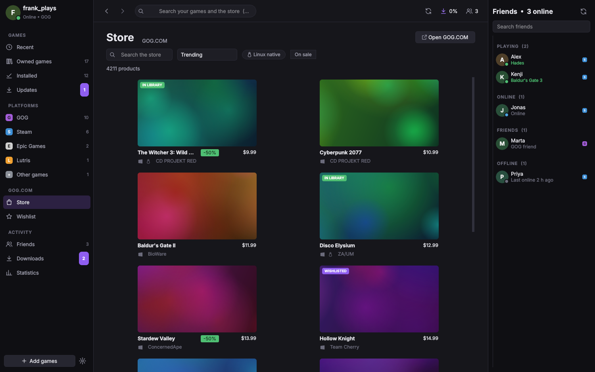
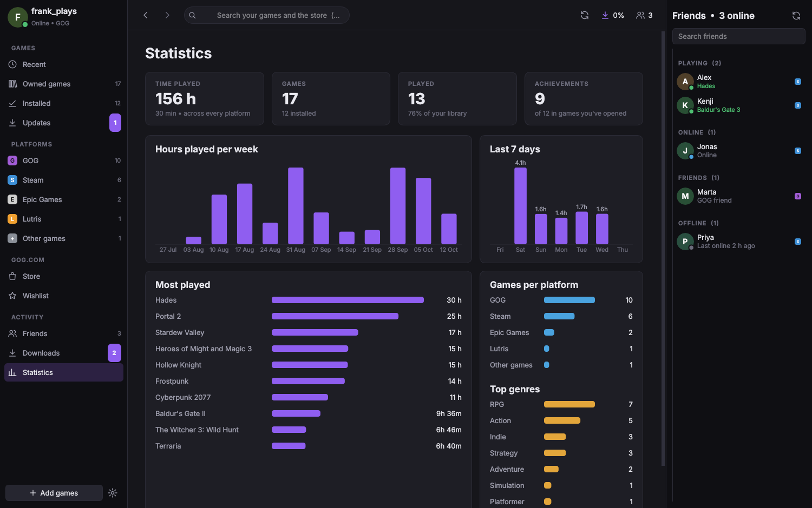
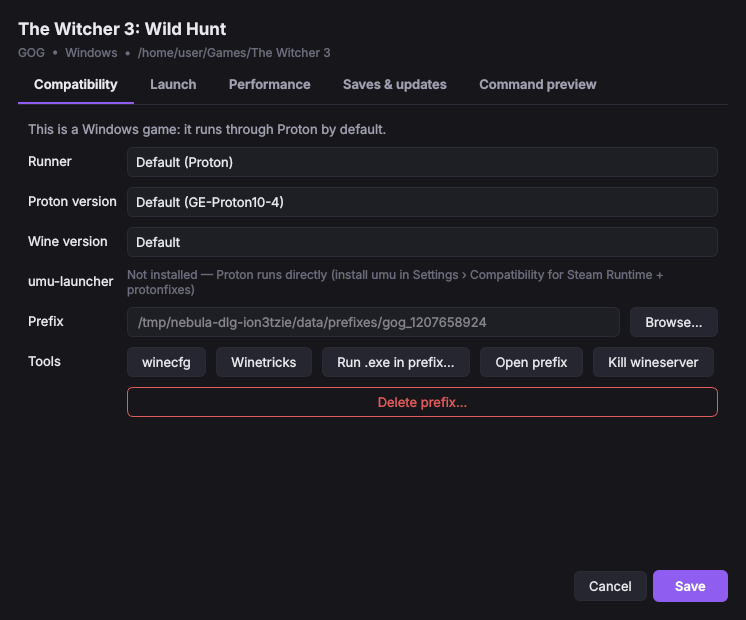

# Nebula — a GOG Galaxy-style launcher for Linux

Nebula puts all your games in one library: **GOG**, **Steam**, **Epic Games** (through Legendary/Heroic),
**Lutris**, games you add yourself, and anything a plugin provides. Its interface and features are modelled on
GOG Galaxy 2.0. **Every Windows-only game runs through Proton automatically.**



| | |
|---|---|
|  |  |
|  |  |
|  |  |

## Proton: Windows games just work

* **Proton is the default** for every game without a native Linux build: GOG Windows builds, Epic games,
  Windows `.exe` files you add by hand, and GOG's Windows offline installers.
* Nebula finds Proton automatically in `~/.steam/.../compatibilitytools.d`, Steam's `steamapps/common/Proton*`,
  system packages and its own runner folder. It prefers the newest **GE-Proton**.
* **One-click GE-Proton download** (Settings › Compatibility, or *Add games › Download GE-Proton*). Downloads are
  checked against their SHA-512 sums before they are unpacked.
* **umu-launcher support.** When `umu-run` is installed (or installed from Settings with one click), Proton runs
  inside the Steam Linux Runtime the way Steam runs it. It also applies per-game **protonfixes**, looked up in the
  umu database by store and game ID. Without umu, Nebula runs `proton waitforexitandrun` itself and supplies the
  environment Steam would provide.
* **One prefix per game**, plus per-game Proton or Wine version, winecfg, winetricks, *Run .exe in prefix*,
  kill wineserver and delete prefix.
* **Tweaks, global or per game:** Feral GameMode, MangoHud, gamescope (with arguments), DXVK HUD, FPS limit,
  esync/fsync, native Wayland, NVAPI/DLSS, environment variables, wrapper commands, extra arguments and
  executable overrides. A *Command preview* tab shows the exact command and environment that will run.
* GOG games that need MSVC, DirectX or .NET get **GOG's redistributables** installed into the prefix on first
  launch, as Galaxy does on Windows.
* GOG's DOS and ScummVM games run on **native DOSBox and ScummVM** when they are installed.



## GOG Galaxy 2.0 features

| Galaxy feature | Nebula |
|---|---|
| Unified library across platforms | ✅ GOG, Steam, Epic (Legendary/Heroic), Lutris, manual games, plugins |
| Same game owned on several platforms merged into one entry | ✅ pick the preferred platform per game |
| Grid and list views, cover size, sorting | ✅ |
| Filters: platform, installed, OS, genre, tags, played, favourites, updates, hidden | ✅ with removable filter chips |
| Custom views saved in the sidebar | ✅ |
| Tags, star rating, favourites, hide game, rename, custom covers | ✅ |
| "Recent" home: continue playing, updates, recently added, your week, activity | ✅ |
| Game page: hero art, description, screenshots, trailers, info, links, changelog | ✅ |
| Install GOG games | ✅ Galaxy content system (generation 2) for Windows builds, native `.sh` installers for Linux builds |
| Choose language, DLC, version and location at install time | ✅ |
| Download queue: pause, resume, cancel, reorder, speed limit, parallel connections | ✅ interrupted installs resume where they stopped |
| Automatic updates and update notifications | ✅ per-game opt-out |
| Roll back to an older version | ✅ any published build; rolling back pins the version |
| Verify / repair game files | ✅ chunk-level MD5 verification; only broken files are re-downloaded |
| Delta updates | ✅ unchanged chunks of changed files are reused from disk |
| Install DLC later, uninstall | ✅ |
| Cloud saves | ✅ GOG cloud storage, synced on launch and exit, with conflict handling. Save paths are resolved inside the Proton prefix. |
| Achievements with rarity | ✅ GOG; Steam with a Web API key. Unlock notifications after each session. |
| Play-time tracking, including games started outside the launcher | ✅ process detection, including Wine/Proton processes and Steam's reaper |
| Play time reported to your GOG profile | ✅ |
| Statistics: hours per week and day, most played, platforms, genres | ✅ |
| Friends list, "now playing" | ✅ GOG friends; Steam friends with status and current game; notifications |
| Online presence shown to GOG friends | ✅ |
| GOG store: browse, search, sort, Linux-only and on-sale filters, product pages | ✅ purchases open gog.com |
| Wishlist | ✅ view, add, remove |
| Scan and import folders | ✅ GOG game folders, plus games installed by Heroic |
| Add a game manually | ✅ Linux binaries, Windows `.exe` (Proton), emulator command lines |
| Extra launch options (editor, settings, manuals) | ✅ from GOG's `playTasks` |
| Install / uninstall / verify Steam and Epic games | ✅ handed to Steam, or run through Legendary with progress shown in Downloads |
| Desktop and menu shortcuts, tray icon, notifications, start minimised | ✅ `nebula --launch gog:<id>` |
| Integrations / plugins | ✅ Python plugin API modelled on Galaxy's integration API |
| In-game overlay | ⚠️ Galaxy's overlay hooks DirectX on Windows, which isn't possible here. MangoHud is offered instead. |
| Chat | ❌ GOG has no public chat API |
| PlayStation, Xbox, Battle.net, Ubisoft, EA | ⚠️ through Lutris (installed games) or a plugin |

## Install

You need Python 3.10 or newer. Then:

```bash
./scripts/install.sh               # per-user install: venv, `nebula` command, menu entry
./scripts/install.sh --webengine   # same, plus the embedded GOG login page
./scripts/install.sh --uninstall
```

To run it from the source tree instead:

```bash
pip install -r requirements.txt
python -m nebula
```

Recommended system packages (all optional): `umu-launcher`, `gamemode`, `mangohud`, `gamescope`, `innoextract`
(unpacks GOG Windows offline installers without Wine), `winetricks`, `legendary` (Epic), `dosbox-staging`,
`scummvm`. Settings › Compatibility › *Detected tools* shows which ones Nebula found.

## Connecting platforms

* **GOG:** click your profile, then *Sign in to GOG*. With PySide6-Addons the login page opens inside Nebula.
  Without it, Nebula opens your browser and you paste the final `on_login_success` address back.
* **Steam:** installed games, play time and artwork are read from your local Steam folder. For games you own but
  haven't installed, plus achievements and friends, add a
  [Steam Web API key](https://steamcommunity.com/dev/apikey) in Settings › Integrations.
* **Epic Games:** sign in once with `legendary auth` or in Heroic. Nebula reads the library and launches games with
  `legendary launch --no-wine --wrapper <Proton>`, so they run with Nebula's Proton settings.
* **Lutris:** detected automatically. Games launch through Lutris.
* **Other games:** use *Add games › Add game manually*.

## Command line

```
nebula                       start, or bring the running window to front
nebula --launch gog:1207658924   launch a game (used by desktop shortcuts)
nebula --minimized           start in the tray
nebula --debug               verbose logging (~/.local/share/nebula/logs)
```

Keyboard shortcuts:

| Keys | Action |
|---|---|
| Ctrl+F | Search |
| Alt+← / Alt+→ | Back / forward |
| F5 or Ctrl+R | Sync all platforms |
| Ctrl+1 … Ctrl+5 | Recent, Owned, Installed, Store, Downloads |
| Ctrl+, | Settings |

## Plugins

Drop a `.py` file into `~/.local/share/nebula/plugins/` and restart Nebula. Any subclass of
`nebula.integrations.base.Integration` in that file becomes a new platform. It can implement any subset of
`fetch_library`, `prepare_launch`, `install`, `achievements`, `friends` and the other methods in
[`nebula/integrations/base.py`](nebula/integrations/base.py).
[`docs/examples/example_plugin.py`](docs/examples/example_plugin.py) is a complete ROM-library example.

## Where things live

| Path | Contents |
|---|---|
| `~/.config/nebula/` | settings, GOG credentials (mode 600) |
| `~/.local/share/nebula/` | library database, Proton prefixes, downloaded Proton/umu, GOG manifests, redistributables, logs |
| `~/.cache/nebula/` | artwork cache, partially downloaded installers |
| `~/Games/Nebula/` | default install folder (change it in Settings › Library) |

## Development

```bash
pip install -e .[dev]
QT_QPA_PLATFORM=offscreen pytest
```

The tests start local HTTP servers that act as GOG's CDN and cloud storage. They run a full GOG install through
these fake servers:

* chunked parallel download, launch-command generation through Proton, delta update, rollback, verify/repair
  and uninstall;
* cloud-save upload, download and conflict handling;
* Proton/umu command lines;
* GE-Proton download and checksum verification;
* the Steam, Epic, Lutris and Linux-installer importers, process detection and the job queue;
* a smoke test that opens every page and dialog.

Code layout:

```
nebula/
  core/          settings, SQLite storage, library merging, job queue, launcher and session tracking, images
  runners/       Proton/Wine detection and command building, GE-Proton and umu downloads
  integrations/  gog/ (auth, API, Galaxy content system, offline installers, cloud saves), steam, epic, lutris, local
  ui/            PySide6 interface: shell, pages, dialogs, widgets, theme
```

## Status and limitations

* GOG's servers could not be reached from the environment Nebula was built in. The GOG protocols (OAuth, Galaxy
  content system, secure links, cloud storage, gameplay, presence) follow the open-source implementations in
  Heroic's *gogdl* and *minigalaxy*, and they are exercised against simulated servers in the test suite. Your
  first real sign-in and install is the first live run. If something fails, run `nebula --debug` and check the
  logs.
* GOG cloud saves work for Windows builds, which keep their saves inside the Proton prefix. GOG doesn't publish
  cloud-save locations for its Linux builds.
* The GOG friends list comes from an undocumented endpoint. Friends' online status isn't available, so they're
  listed without presence.
* Nebula signs in with the public GOG Galaxy client ID that all open-source GOG launchers use. It is not
  affiliated with GOG sp. z o.o., Valve, Epic Games or Lutris. Store pages and artwork belong to their owners.

## Credits

Protocol knowledge comes from [heroic-gogdl](https://github.com/Heroic-Games-Launcher/heroic-gogdl),
[minigalaxy](https://github.com/sharkwouter/minigalaxy), the community
[GOG API documentation](https://gogapidocs.readthedocs.io/),
[umu-launcher](https://github.com/Open-Wine-Components/umu-launcher) and
[GE-Proton](https://github.com/GloriousEggroll/proton-ge-custom).
